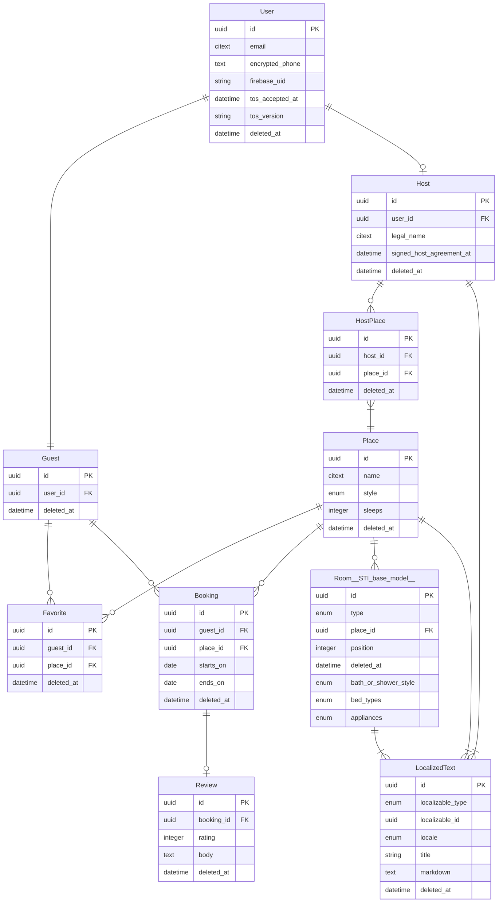

# BearBnB

An AirBnB clone for bears to demonstrate [Dream ORM](https://github.com/rvohealth/dream) and [Psychic web framework](https://github.com/rvohealth/psychic).

A good way to follow along with building a new Psychic app is:

1. Have PostgreSQL and Redis running.
2. Create a new Psychic app with `npx @rvoh/create-psychic new bearbnb`.
3. Start with the third commit in this repo (`Generate User model`).
4. Then follow along with the changes, commit by commit, making the changes in your project. The commits are broken down into generated code and hand coded features, and commit messages include generator commands that were run.

Full guides available at [https://psychicframework.com/](https://psychicframework.com/).

### AI

This project ships with AI tooling for Dream and Psychic development.

**Psychic-skill** — If you chose to install the psychic-skill during setup, it provides comprehensive rules and conventions for Dream and Psychic development. Codex reads it from `.agents/skills/psychic-skill`. When you selected both Claude and Codex, that is the single committed copy and `.claude/skills/psychic-skill` references it (a symlink repaired on `install` by a root `postinstall`, or a real copy under npm); Claude Code loads it automatically either way.

**AI rules** — `./api/CLAUDE.md` and `./api/AGENTS.md`\* direct your agent to the **psychic-skill**, which is the single source of truth for Dream and Psychic conventions, patterns, and rules. Update the skill itself (via `/psychic-update-skill` or `git fetch origin && git reset --hard origin/main && ./setup` inside the skill directory) to get the latest guidance.

\* if this Psychic app was created without a front-end client, then these files are in the project root

## Fresh clone setup

BearBnB requires Node 26 or newer, pnpm, PostgreSQL, and Redis. The repository has no root `package.json`, so install each package separately from the repository root:

```bash
pnpm --dir api install
pnpm --dir client install
pnpm --dir admin install
pnpm --dir internal install
```

Copy the complete local-development and test environment templates:

```bash
cp api/.env.example api/.env
cp api/.env.test.example api/.env.test
```

In both copied files:

1. Replace `<db-user>` and `<db-password>` with your local PostgreSQL credentials. Leave `DB_PASSWORD` empty if your local PostgreSQL connection does not require one.
2. Replace `APP_ENCRYPTION_KEY` and `COLUMN_ENCRYPTION_KEY` with separate keys. Generate them by running `pnpm --dir api psy g:encryption-key` twice from the repository root.

The copied files already contain the local Firebase Auth emulator configuration and the distinct development/test database names. They are ignored by Git and must not be committed.

Create and migrate both databases from `api/`:

```bash
cd api
NODE_ENV=development pnpm psy db:create
NODE_ENV=development pnpm psy db:migrate
pnpm psy db:create
pnpm psy db:migrate
```

## Running specs locally

Run commands from `api/`:

```bash
pnpm uspec
pnpm fspec
```

`pnpm fspec` starts and stops the Firebase Auth emulator and front-end test servers automatically.

## Running the app locally

With PostgreSQL and Redis running, start the full development stack from `api/`:

```bash
pnpm dev
```

`pnpm dev` starts the backend, worker, websocket server, client, and Firebase Auth emulator together. Stop everything with `Ctrl-C`.

## State of the repo

The client app is a working front end: browse places, sign in with Firebase email/password at `/auth`, then book stays, review, and favorite places as a guest, or become a host and manage places and rooms in English and Spanish. The admin and internal apps remain the default create-psychic scaffolds. End-to-end feature specs cover the guest and host flows and self-manage the Firebase Auth emulator when you run `pnpm fspec`.

## Entity Relationship Diagram (ERD) of the BearBnB model domain



## Generator commands used to create BearBnB

```bash
pnpm psy g:model --no-serializer User email:citext phone:encrypted
pnpm psy g:model Guest User:belongs_to
pnpm psy g:model Host User:belongs_to
pnpm psy g:resource --owning-model=Host v1/host/places Place name:citext style:enum:place_styles:cottage,cabin,lean_to,treehouse,tent,cave,dump sleeps:integer
pnpm psy g:model --no-serializer HostPlace Host:belongs_to Place:belongs_to

pnpm psy g:resource --sti-base-serializer --owning-model=Place 'v1/host/places/{}/rooms' Room type:enum:room_types:Bathroom,Bedroom,Kitchen,Den,LivingRoom Place:belongs_to position:integer:optional
pnpm psy g:sti-child --model-name=Bathroom Room/Bathroom extends Room bath_or_shower_style:enum:bath_or_shower_styles:bath,shower,bath_and_shower,none
pnpm psy g:sti-child --model-name=Bedroom Room/Bedroom extends Room 'bed_types:enum[]:bed_types:twin,bunk,queen,king,cot,sofabed'
pnpm psy g:sti-child --model-name=Kitchen Room/Kitchen extends Room 'appliances:enum[]:appliance_types:stove,oven,microwave,dishwasher'
pnpm psy g:sti-child --model-name=Den Room/Den extends Room
pnpm psy g:sti-child --model-name=LivingRoom Room/LivingRoom extends Room

pnpm psy g:resource --only=update,destroy v1/host/localized-texts LocalizedText localizable_type:enum:localized_types:Host,Place,Room localizable_id:uuid locale:enum:locales:en-US,es-ES title:string markdown:text
pnpm psy g:controller Visitor/V1/Places index show

pnpm psy g:migration add-deferrable-unique-constraint-on-rooms
pnpm psy g:migration make-natural-key-unique-indexes-partial

pnpm psy g:controller Status show
pnpm psy setup:sync:openapi-zustand --schema-file=./src/openapi/openapi.json --output-dir=../client/src/api/backend/generated --client-config-file=../client/src/api/backend/client.ts --export-name=backendApi
pnpm psy g:migration add-firebase-uid-to-users firebase_uid:string:optional
pnpm psy g:migration allow-null-phone-on-users
pnpm psy g:controller Visitor/V1/Me show
pnpm psy g:migration add-tos-consent-to-users tos_accepted_at:datetime:optional tos_version:string:optional
pnpm psy g:controller Visitor/V1/SignUp create

pnpm psy g:resource --only=index,create,destroy --owning-model=Guest v1/guest/favorites Favorite Guest:belongs_to Place:belongs_to
pnpm psy g:resource --only=index,create,update,destroy --owning-model=Guest v1/guest/bookings Booking Guest:belongs_to Place:belongs_to starts_on:date ends_on:date
pnpm psy g:resource --only=index,create,update,destroy --owning-model=Guest v1/guest/reviews Review Booking:belongs_to rating:integer body:text
pnpm psy g:controller Visitor/V1/Places/Reviews index

pnpm psy g:migration add-legal-fields-to-hosts legal_name:citext signed_host_agreement_at:datetime
pnpm psy g:controller V1/Host show create update
```

The `v1/host/localized-texts` controller and route generated above were later removed: LocalizedTexts are written through their owning Host, Place, and Room endpoints.
